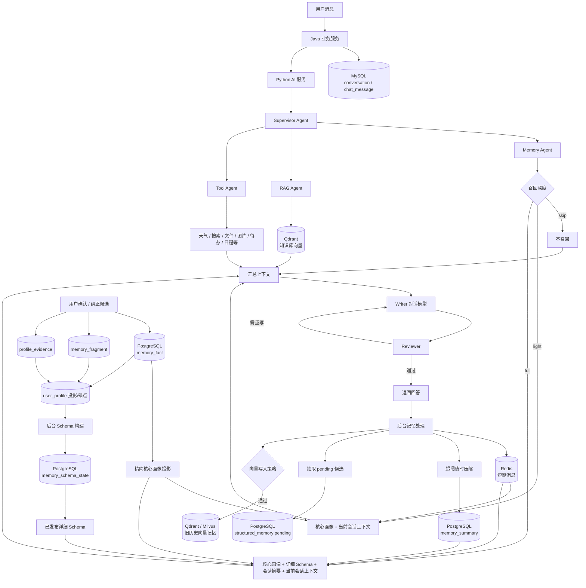

# Lyle 记忆系统架构与各类记忆说明

> 本文描述 `ai-service-python` 当前代码中的记忆实现，用于帮助开发、测试和产品人员理解记忆如何产生、存储、召回、注入模型及被治理。
>
> 相关专项文档：[`MEMORY_CONSTRUCTION_AND_RECALL.md`](./MEMORY_CONSTRUCTION_AND_RECALL.md)、[`MEMORY_B_ARCHITECTURE.md`](./MEMORY_B_ARCHITECTURE.md)。

## 1. 核心结论

Lyle 的“记忆”不是一张表或一个数据库，而是按职责拆分的多层系统：

- MySQL 保存原始会话和消息，是可回放的聊天记录，不会整库直接投给模型。
- Redis 保存当前会话最近消息，是短期工作上下文。
- PostgreSQL 保存会话摘要、候选记忆、权威事实、画像、证据、冲突、治理事件和已发布 Schema。
- Qdrant/Milvus 保存旧模式的历史语义向量索引；新 Schema 模式不允许它们绕过确认和治理，直接召回长期个人事实。
- `memory_fact` 是当前长期确认事实的权威来源；`user_profile` 是按 Schema 路径汇总后的投影和管理锚点；已发布 Schema 是允许详细召回的版本化派生产物。
- 最终只有通过场景选择、状态检查、证据检查、敏感过滤和字符预算的记忆，才会进入 `memory_context` 并提供给对话模型。

## 2. 总体架构图



## 3. 一轮对话中的召回与回答

```text
用户发送消息
   │
   ├─ 原始用户消息写入 MySQL
   │
   ├─ Supervisor 判断是否需要记忆、知识库和工具
   │
   ├─ Memory Agent 判断召回深度
   │      ├─ skip：空输入或旧兼容模式下的精确短问候
   │      ├─ light：核心画像 + 当前会话最近消息
   │      └─ full：核心画像 + 详细 Schema + 会话摘要 + 最近消息
   │
   ├─ RAG Agent 查询知识库（按需）
   ├─ Tool Agent 执行工具（按需）
   ├─ 服务端将可用内容汇总为 memory_context / tool_context / contexts
   ├─ Writer 接收用户问题和上述上下文，生成回答
   ├─ Reviewer 检查回答，必要时让 Writer 重写
   ├─ 助手回答和本轮使用记忆说明写入 MySQL
   │
   └─ 回答结束后后台处理
          ├─ 用户消息和助手回答加入 Redis 短期记忆
          ├─ 超过阈值时压缩较早消息并写入 PostgreSQL 摘要
          ├─ 从用户消息中抽取 pending 结构化候选
          └─ 按过滤及查重策略写入旧向量记忆索引
```

召回不是固定的“先让一个模型写记忆总结，再让另一个模型回答”。当前实现更接近：

```text
代码/召回模型选择必要字段
  → 服务端形成 memory_context
  → Writer 对话模型回答
  → Reviewer 审核
```

Schema 较小时可直接按规则选择；Schema 较大时可由只读召回 Agent 通过 `read_schema`、`search_schema`、`finish` 多轮选择路径。无可用召回模型或协议失败时回退到规则选择。

## 4. 各类记忆及存储位置

| 类型 | 主要存储 | 作用 | 是否属于已确认长期事实 |
|---|---|---|---|
| 原始会话记录 | MySQL `conversation`、`chat_message` | 历史会话、消息回放、重试和来源定位 | 否 |
| 短期记忆 | Redis List | 理解最近几轮中的代词、省略和连续追问 | 否 |
| 会话压缩摘要 | PostgreSQL `memory_summary` | 压缩当前会话较早内容，减少上下文长度 | 否 |
| pending 候选记忆 | PostgreSQL `structured_memory` | 保存自动抽取但尚未确认的候选 | 否 |
| 权威记忆事实 | PostgreSQL `memory_fact` | 保存用户确认、纠正后的单条事实及版本状态 | 是 |
| 事实所有者/迁移元数据 | PostgreSQL `memory_fact_owner` | 保存用户级迁移状态和事实层元数据，并提供写入锁边界 | 管理数据 |
| 用户画像 | PostgreSQL `user_profile` | 将事实按 Schema 路径投影，保留 UI、来源外键和使用统计锚点 | 是事实的投影，不是第二事实源 |
| 记忆片段 | PostgreSQL `memory_fragment` | 保存事实来自哪句话、消息、文档片段或人工操作 | 证据数据 |
| 画像证据关系 | PostgreSQL `profile_evidence` | 连接画像与片段，标识支持、补充、纠正等关系 | 证据数据 |
| 记忆冲突 | PostgreSQL `memory_conflict` | 保存待处理的新旧事实冲突和处理结果 | 治理数据 |
| 治理事件 | PostgreSQL `memory_governance_event` | 记录修改、停用、恢复、遗忘等操作前后快照 | 审计数据 |
| 永久删除任务 | PostgreSQL `memory_purge_job` | 异步清理事实、来源和 Schema 派生数据 | 治理任务 |
| 已发布 Schema | PostgreSQL `memory_schema_state.state_json` | 保存后台构建队列、版本和可召回快照 | 是长期事实的可召回派生版本 |
| 语义/向量记忆 | Qdrant、可选 Milvus | 旧模式下按语义相似度检索历史用户消息 | 否，可能过时 |
| 本轮实际使用记录 | MySQL 助手消息 `metadata_json` | 向前端解释本轮使用了哪些记忆及原因 | 使用轨迹 |

当 PostgreSQL、Redis 等基础设施被显式关闭时，部分模块会退回 Python 进程内字典。进程内数据不跨重启，也不适用于多进程生产部署。向量后端不可用时会跳过或进入短暂冷却，而不是把向量数据持久化到进程内存。

## 5. 各类记忆详细说明

### 5.1 原始会话记录

原始聊天由 Java 服务写入 MySQL。它主要用于历史页面、来源回放、消息重试和审计。它是记忆提取的来源之一，但不会在每次回答时把整个会话表直接提供给模型。

删除或治理长期记忆也不等于自动删除原始聊天记录；二者有不同的生命周期和产品语义。

### 5.2 Redis 短期记忆

Redis Key 格式：

```text
memory:short:{user_id}:{conversation_id}
```

每轮完成后追加用户消息和助手回答。默认配置为：

- 最终保留最近 12 条；
- 超过 24 条时触发压缩；
- 单次召回默认取最近 6 条；
- Redis 异常时退回当前 Python 进程内存。

短期记忆适合回答“刚才说的那个”“继续上一步”等问题，但它不是用户确认的长期事实。

### 5.3 会话压缩摘要

`memory_summary` 按 `user_id + conversation_id` 保存。短期消息超过阈值后，系统把较早消息和旧摘要交给摘要任务合并，再裁剪 Redis 中的消息。

摘要只代表会话背景，注入模型时标注为“非已确认的长期事实”。它不能自动升级为画像或 Schema 事实，且只在 full 召回中使用。

### 5.4 pending 结构化候选

系统通过规则或记忆模型从用户消息中抽取职业、偏好、目标、项目、沟通方式等候选。候选首先写入 `structured_memory`，状态为 `pending`。

pending 候选：

- 可以展示给用户确认、编辑或忽略；
- 不能进入已发布 Schema；
- 不能作为已确认个人事实注入回答；
- 命中候选的原消息默认不再写入旧向量记忆，防止绕过确认。

### 5.5 权威事实 `memory_fact`

新模式中，`memory_fact` 是确认事实的唯一当前写入口。每条事实包含：

- `factId`；
- `schemaPath`；
- `value`；
- `status`；
- `revision`；
- `confidence`；
- `expiresAt`；
- 来源标识和更新时间。

单值槽位的新值可以替换旧事实；多值槽位可以保存多个独立事实。被替换的事实可以保留为 `superseded` 历史。修改时可使用 revision 做并发检查，避免旧请求覆盖新值。

### 5.6 用户画像 `user_profile`

用户画像不是另一套独立事实库。当前模式下，它是 `memory_fact` 按 `schemaPath` 聚合后的只读投影，同时保留旧 UI 链接、证据外键和使用统计需要的稳定 ID。

可以简单理解为：

```text
memory_fact = 底层单条事实
user_profile = 按字段整理后的当前视图
```

例如两个有效事实：

```text
preferences.output_style = 简洁
preferences.output_style = 使用表格
```

可以投影成：

```text
输出风格：简洁、使用表格
```

### 5.7 核心画像

核心画像不是新的数据库，而是从当前权威事实即时生成的小型只读投影。默认包括：

- 互动边界；
- 互动触发点；
- 沟通风格；
- 输出风格；
- 语言；
- 语言习惯；
- 称呼/姓名；
- 当前职业。

它用于保证常规对话也能稳定遵循关键偏好，不需要等待详细 Schema 构建。默认最多 1200 字符，过长条目整条跳过；敏感、控制、冲突、失效、过期或低置信度事实不注入。

### 5.8 记忆片段与证据

记忆来源链路为：

```text
原始消息或文档
  → memory_fragment
  → profile_evidence
  → memory_fact / user_profile
  → 已发布 Schema
```

`memory_fragment` 保存原文、规范化文本、来源类型、会话、消息或文档片段标识；`profile_evidence` 保存该片段与画像之间的关系。它们用于来源回放、可靠性计算、冲突处理和永久删除，不会把所有证据原文默认塞给回答模型。

### 5.9 已发布 Schema

已发布 Schema 是详细长期记忆的版本化召回入口。后台构建器只接收当前有效、非敏感、非控制、置信度至少 0.75 且来源有效的确认事实。

构建过程：

```text
事实或来源发生变化
  → 标记 Schema pending
  → Worker 领取任务
  → 收集当前确认事实与有效来源
  → 按槽位增量归档、去重、合并
  → 校验路径、事实修订和来源覆盖
  → 原子发布完整 Schema vN
```

配置了记忆模型且开启 `MEMORY_SCHEMA_BUILD_WITH_LLM=true` 时，可由模型做受约束的归档和表达合并；否则使用确定性构建。模型不能新增路径、推测新事实或引用不存在的来源。构建失败不会发布半份 Schema。

默认保留最近 3 个成功版本。事实被修改、停用、遗忘、过期或发生冲突后，旧槽位即使仍在旧快照中，也会因事实或来源指纹不一致而在召回时被过滤。

### 5.10 向量记忆

向量记忆当前保存的是经过清洗的用户消息，而不是“用户问题 + 助手回答”，也不会拼接其他画像：

```text
用户：{当前用户消息}
```

默认最多 500 字符。写入前会：

1. 过滤空消息；
2. 过滤“你好、谢谢、好的、继续吧”等无信息寒暄；
3. 过滤过短且无长期价值信号的消息；
4. 过滤已产生 pending 候选或命中治理规则的消息；
5. 在 Qdrant 中查重，相似度达到默认 0.92 时跳过；
6. 将文本转为向量后写入 Qdrant，并在 Milvus 启用时同步写入 Milvus。

Qdrant 集合默认为 `lyle_semantic_memory`；Milvus 集合默认为 `lyle_vector_memory`。当前 Docker 主部署开启 Qdrant、关闭 Milvus。

当 `MEMORY_SCHEMA_ENABLED=true` 时，向量记忆不会参与长期个人事实召回。只有关闭 Schema、进入旧兼容模式时，系统才会搜索 Qdrant/Milvus、过滤低于默认 0.5 的结果、合并去重并可选重排，然后以“可能过时的历史片段”注入模型。

## 6. 三种召回深度

| 深度 | 使用场景 | 主要内容 |
|---|---|---|
| `skip` | 空输入；未启用新事实层时的精确短问候/确认语 | 不提供记忆上下文 |
| `light` | 普通对话；新事实层下的短问候 | 精简核心画像、当前会话最近消息，不使用摘要和向量 |
| `full` | 用户个人信息、历史、偏好、项目、目标、规划等问题 | 核心画像、详细 Schema、当前会话摘要、最近消息；旧兼容模式才可能加入向量片段 |

不论哪种深度，最终都还要经过以下过滤：

- 必须属于当前用户；
- 状态必须可用；
- 置信度满足阈值；
- 不能是敏感或控制槽位；
- 不能命中停用、遗忘、冲突、过期等治理规则；
- 来源和事实修订必须仍然有效；
- 必须处于本轮允许路径和字符预算内。

## 7. 记忆如何进入模型

服务端会把最终选中的内容编译为 `memory_context`，示例：

```text
用户画像：
- 当前职业：后端开发
- 输出风格：偏好简洁回答
- 互动边界：生产删除操作必须先确认

当前会话上下文（非已确认的长期事实）：
user：刚才我们讨论了部署方案
assistant：已经完成测试环境检查
```

Writer 最终接收：

```text
系统提示词
+ 当前运行时间和安全规则
+ 用户问题
+ memory_context
+ RAG 知识库资料
+ tool_context
```

Reviewer 随后使用同一批可用上下文检查回答是否误用记忆、遗漏边界或与知识库/工具结果冲突。审核不通过时，Writer 会带着审核意见重写。

`usedMemories` 只记录实际通过预算并注入的记忆，而不是所有候选或所有被检索到的字段。它会随助手消息元数据保存，用于前端展示“本轮使用了哪些记忆”。

## 8. 工具与记忆的关系

Tool Agent 当前注册以下工具：

| 工具 | 用途 |
|---|---|
| `health_check` | 检查 AI 服务和 Reranker 状态 |
| `memory_snapshot` | 查看当前用户记忆概况 |
| `memory_stats` | 统计 PostgreSQL 记忆数据 |
| `work_summary` | 汇总待办、项目、目标和计划 |
| `web_search` | 联网搜索，默认关闭 |
| `weather` | 查询天气 |
| `file_parse` | 解析允许范围内的文件 |
| `image_analyze` | 分析图片 |
| `image_generate` | 生成图片 |
| `image_edit` | 修改图片 |
| `todo` | 生成待办写入预览，确认后执行 |
| `calendar` | 生成日程写入预览，确认后执行 |
| `list_tools` | 查询当前可用工具及状态 |

工具结果形成 `tool_context` 后与 `memory_context` 一起交给 Writer，但工具数据不因此自动变成长期记忆。待办、日程、项目等应继续由各自业务系统维护真实状态；只有明确且适合长期保存的用户事实，才进入候选确认和事实链路。

Memory Agent、RAG Agent、Reviewer Agent 以及 Schema 内部的 `read_schema/search_schema` 是编排能力，不属于上述通用工具注册表。

## 9. 数据职责速查

```text
想看完整历史聊天        → MySQL chat_message
想理解“刚才那个”        → Redis 短期记忆
想保留长会话早期背景      → PostgreSQL memory_summary
想等用户确认一个事实      → structured_memory pending
想保存确认后的单条事实     → memory_fact
想按字段展示用户当前资料    → user_profile 投影
想说明事实从哪里来         → memory_fragment + profile_evidence
想处理新旧事实冲突         → memory_conflict
想记录停用/纠正/遗忘操作    → memory_governance_event
想让详细长期记忆可安全召回   → memory_schema_state 已发布 Schema
想做旧历史片段语义相似检索   → Qdrant / Milvus
想解释本轮真正用了什么      → usedMemories + 助手消息 metadata_json
```

## 10. 主要代码入口

| 职责 | 文件 |
|---|---|
| Memory Agent 决策 | `app/agents/memory_agent.py` |
| 记忆写入、压缩、召回和向量策略 | `app/memory/store.py` |
| 权威事实 | `app/memory/fact_store.py` |
| 核心画像投影 | `app/memory/layered_context.py` |
| 画像上下文和 usedMemories | `app/memory/context_builder.py` |
| 画像 Schema 定义 | `app/memory/profile_schema.py` |
| 画像兼容门面 | `app/memory/profile_store.py` |
| 片段与证据 | `app/memory/fragments.py`、`app/memory/evidence_store.py` |
| Schema 构建 | `app/memory/schema_builder.py` |
| Schema 队列与版本存储 | `app/memory/schema_store.py` |
| Schema 召回 | `app/memory/schema_recall.py` |
| 召回策略和预算 | `app/memory/recall_policy.py` |
| 多 Agent 编排 | `app/graphs/multi_agent_graph.py` |
| Writer Prompt 拼装 | `app/llm/prompts.py` |
| 通用工具注册 | `app/tools/tool_registry.py` |
| 工具风险策略 | `app/tools/risk_policy.py` |

## 11. 重要边界

- 原始聊天、短期上下文、会话摘要都不能自动升级为确认事实。
- pending 候选必须经过用户确认才会成为有效长期记忆。
- `memory_fact` 是当前事实源，`user_profile` 和 Schema 都是派生层。
- 核心画像来自事实即时投影，不是额外复制的一份记忆。
- Schema 是只读发布版本，不允许聊天模型直接修改。
- 向量历史可能过时，新模式不允许其绕过 Schema 和治理。
- 敏感、控制、冲突、停用、遗忘、过期和低置信度内容不会正常注入回答。
- 工具执行结果不会自动成为长期记忆。
- PostgreSQL/Redis 的进程内回退只适合测试或单进程开发，不提供生产持久性。
